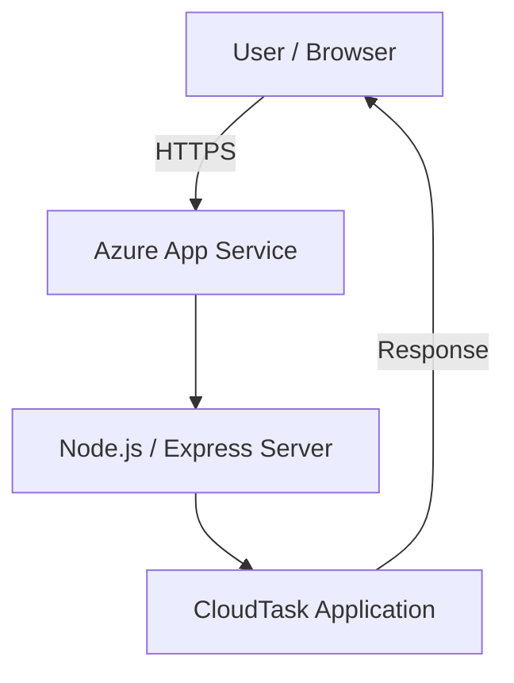

# ☁️ CloudTask

### A Cloud-Hosted Task Management System

CloudTask is a lightweight task management web application developed as part of an academic Cloud Computing project. It provides a simple interface for managing everyday tasks while demonstrating the deployment of a web application on Microsoft Azure.

## 🚀 Live Demo

<p align="center">
  <a href="https://cloudtask-web-ekfvbrfmhhgmb7ec.centralindia-01.azurewebsites.net/">
    
  </a>
</p>

**🌐 Website:** https://cloudtask-web-ekfvbrfmhhgmb7ec.centralindia-01.azurewebsites.net/

## 📸 Preview

<!-- Add screenshots of your application here -->

## ✨ Features

- Create and manage tasks
- Simple and intuitive user interface
- Interactive task management
- Task editing and deletion
- Responsive web interface
- Cloud-hosted application accessible over the internet

## 🛠️ Tech Stack

| Technology | Purpose |
|---|---|
| HTML5 | Application structure |
| CSS3 | Styling and UI design |
| JavaScript | Frontend interactivity |
| Node.js | Backend runtime |
| Express.js | Backend web server |
| Microsoft Azure App Service | Cloud hosting |
| Git & GitHub | Version control |

## 🏗️ Architecture



## ☁️ Cloud Deployment

CloudTask is deployed using **Microsoft Azure App Service**, a Platform as a Service (PaaS) solution.

The application is hosted on Azure and accessible through a publicly available HTTPS endpoint.

## 💻 Run Locally

### Prerequisites

- Node.js
- npm
- Git

### Installation

```bash
# Clone the repository
git clone https://github.com/Spartacus1729/cloudtask.git

# Navigate to the project directory
cd cloudtask

# Install dependencies
npm install

# Start the application
npm start
```

Open your browser and navigate to:

http://localhost:3000

## 🎯 Project Objectives

- Understand cloud computing concepts through practical implementation.
- Deploy a web application using Microsoft Azure.
- Explore cloud application hosting using Azure App Service.
- Demonstrate the accessibility and scalability advantages of cloud infrastructure.
- Gain hands-on experience with cloud deployment.

## 👨‍💻 Contributors

Developed as an academic Cloud Computing project.

## 📄 License

This project is intended for educational purposes.

---
